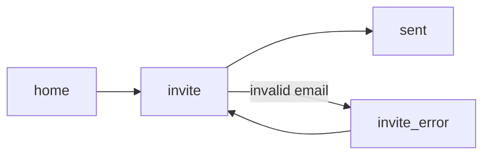

# Prototype: [Name]

> **Field Definitions** — use for output validation.
>
> | Field | Required | Type | Validation |
> |-------|----------|------|------------|
> | Test question | yes | text | one question |
> | Tasks | yes | list | min 1 |
> | Format | yes | enum | single_file_html / nextjs_routes |
> | Fidelity | yes | enum | low / mid / high |
> | Screens | yes | list | min 2; each with states |
> | Paths | yes | list | include ≥1 error/recovery per task |
> | Verified by | yes | enum | browser / code read |

## Prototype Goal
- Test question:
- Tasks:
  1.
- Format:
- Fidelity:
- Real:
- Faked:

## Screen & Path Map

| Screen | Route | States included |
|--------|-------|-----------------|
| | `#/…` | default, empty, loading, error, success |

## Files
- `path`

## Verification

| Path / state | Verified by (browser / code read) | Result |
|--------------|-----------------------------------|--------|
| | | |

## Facilitator Guide
- Open:
- Reset:
- Trigger states:
- Known limitations / fakes:

## Assumptions
-
